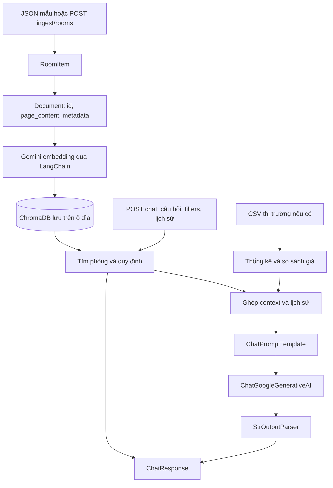

# Thay đổi RAG service: LangChain, Gemini và ChromaDB

Cập nhật: **14/10/2026**. Tài liệu bàn giao các thay đổi đang có trên nhánh
`fix/rag-service`, bao gồm phần resolve conflict sau khi merge code mới và áp dụng stash.

## 1. Mục tiêu và phạm vi

- Thống nhất cách khởi tạo Gemini và tạo chain cho chatbot và phân tích định giá.
- Dùng LangChain cho chat model, embedding, prompt và truy xuất ChromaDB.
- Bỏ model/embedding giả lập khỏi ứng dụng; yêu cầu API key khi khởi động.
- Giữ dữ liệu phòng, quy định và lịch sử hội thoại trong ngữ cảnh trả lời.
- Dọn hàm cũ không còn được gọi, bổ sung ghi chú để dễ đọc code.

**Lưu ý khi review diff:** code mới merge từ nhánh chung đã có triển khai LangChain
trong `langchain_components.py`. Thay đổi cuối cùng hợp nhất về `GeminiClient` và
loại bỏ triển khai trùng đó, không phải toàn bộ chức năng trong service đều được
viết mới trong lần sửa này.

## 2. Luồng hiện tại



- Chroma adapter tự gọi embedding khi `add_documents()` và khi truy vấn.
- Mỗi phòng hoặc quy định là một document; chưa chia nhỏ bằng text splitter.
- `create_chain()` chỉ dựng chuỗi; `.invoke()` mới thực thi và gọi model.
- CSV chỉ phục vụ thống kê thị trường, chưa tự đưa các tin trong CSV vào ChromaDB.

## 3. Thay đổi theo file

### `app/core/gemini_client.py` — giữ làm nơi khởi tạo AI dùng chung

- Tạo `ChatGoogleGenerativeAI` từ `GEMINI_MODEL`.
- Tạo `GoogleGenerativeAIEmbeddings` từ `GEMINI_EMBEDDING_MODEL`.
- Dùng Gemini Developer API (`vertexai=False`) và API key từ cấu hình.
- Bỏ các nhánh model/embedding giả lập. Key rỗng hoặc chỉ có khoảng trắng làm
  khởi tạo thất bại; việc kiểm tra này không xác nhận key có hợp lệ với Google.
- Cung cấp `create_chain(prompt)` theo dạng:

  ```python
  prompt | self.model | StrOutputParser()
  ```

- Namespace dựa trên hash tên embedding model, để không trộn vector của các model.
- Bỏ hàm bọc `generate_content()` và hàm `is_available()` không còn cần trong ứng dụng.

### `app/core/langchain_components.py` — đã xóa

Module từ nhánh mới merge có cùng trách nhiệm với `GeminiClient`, đồng thời còn
`DevelopmentHashEmbeddings` và fallback chat model. Sau resolve, các nơi sử dụng
đều import `gemini_client`; ứng dụng không còn dùng module này.

### `app/core/vector_store.py` — quản lý dữ liệu qua LangChain Chroma

- Dùng `chromadb.PersistentClient` và hai adapter `Chroma` cho phòng/quy định.
- `format_room_text()` tạo đầy đủ văn bản phòng, bao gồm các chi phí có dữ liệu,
  tiện ích, nội quy, mô tả và liên hệ; xử lý các trường tùy chọn bị thiếu.
- `add_rooms()` / `add_policy_documents()` tạo `Document` và upsert bằng ID cố định.
  ID trùng được cập nhật; bản ghi vắng mặt trong request không bị xóa.
- Metadata lưu riêng giá, quận, diện tích và các thông tin cần dựng response.
- `search_rooms()` kết hợp tìm kiếm vector với bộ lọc thành phố, quận, loại phòng,
  giá thấp nhất/cao nhất; trả document, metadata, ID và distance.
- `search_policies()` dùng `as_retriever().invoke()`.
- Kho rỗng trả danh sách rỗng. Lỗi truy vấn không âm thầm bỏ bộ lọc để tìm lại.
- Giữ `count_rooms()` và `count_policies()` để tương thích startup/health check
  của code mới merge. Các ghi chú tiếng Việt được giữ lại sau resolve.

### `app/services/rag_chat_service.py` — điều phối chatbot

- Dùng `CHAT_PROMPT`, `MessagesPlaceholder` và chain dùng chung từ `GeminiClient`.
- Tìm tối đa 4 phòng và 2 quy định cho mỗi câu hỏi.
- Ghép văn bản phòng, quy định và nhận xét CSV nếu có vào prompt.
- Đưa tối đa 6 tin nhắn lịch sử gần nhất vào prompt bằng message có vai trò.
  Lịch sử do client gửi, chưa được service lưu vào database.
- Trả `answer`, `matched_rooms`, `source_documents`, `suggested_follow_ups`.
- Bỏ nhánh trả lời giả lập và hàm bọc tạo câu trả lời cũ. Lỗi gọi model truyền lên
  API route để xử lý.
- Câu hỏi gợi ý vẫn được chọn bằng điều kiện Python, không phải model sinh.

### `app/services/pricing_service.py` — chuẩn hóa phần phân tích AI

- Dùng `PRICING_PROMPT` với các biến đầu vào và gọi trực tiếp `self.chain.invoke()`.
- Bỏ các hàm bọc `_generate_ai_market_analysis()` và `_evaluate_against_market_data()`;
  nội dung đang dùng được đưa về luồng xử lý chính.
- Giá đề xuất vẫn do công thức Python tính từ quận, diện tích, loại phòng, tiện ích
  và đặc điểm; Gemini viết nhận xét. Chưa có mô hình dự đoán giá được huấn luyện.
- CSV và phòng tham khảo được đưa vào phần phân tích, chưa điều chỉnh công thức giá.

### `app/services/market_data_service.py` và `market_evaluator.py`

- Bỏ các tham số diện tích/tiêu đề chưa được bộ đánh giá sử dụng và cập nhật nơi gọi.
- Xóa `create_evaluation_context()` và `_extract_field()` của luồng cũ, không còn caller.
- Rút gọn thao tác lấy các phòng có giá gần nhất, giữ kết quả đầu ra.
- Giữ logic thống kê CSV bằng Pandas/NumPy. Đây là nghiệp vụ cần thiết cho phần
  so sánh thị trường, không cần thay bằng lời gọi LLM.

### Cấu hình, dependency và tài liệu

| File | Thay đổi |
| --- | --- |
| `app/config.py` | Đổi embedding model mặc định sang `models/gemini-embedding-001`; thêm ghi chú |
| `.env.example` | Cập nhật embedding model mẫu tương ứng |
| `.env` trên máy phát triển | Đổi embedding model từ `models/text-embedding-001` bị lỗi 404 sang model khả dụng; giữ API key và model chat |
| `requirements.txt` | Khai báo trực tiếp ChromaDB, giới hạn major version các package LangChain |
| `app/models/schemas.py` | Thêm ghi chú về request/response; cấu trúc API được giữ |
| `app/api/routes_chat.py` | Thêm ghi chú endpoint |
| `README.md` | Bổ sung luồng LangChain, hướng dẫn cấu hình và chuyển chỉ mục |
| `.gitignore` | Ignore thư mục ghi chú cá nhân `document/` |

Các dependency liên quan trực tiếp:

```text
chromadb>=1.3.5,<2
langchain-core>=1.6.10,<2
langchain-google-genai>=4.4.1,<5
langchain-chroma>=1.1.0,<2
```

## 4. API và tích hợp với service khác

| Endpoint | Chức năng |
| --- | --- |
| `GET /health` | Trạng thái và số bản ghi phòng/quy định |
| `POST /api/v1/ingest/rooms` | Nhận danh sách phòng để thêm/cập nhật chỉ mục |
| `POST /api/v1/ingest/init-sample-data` | Nạp lại hai file JSON mẫu |
| `POST /api/v1/chat` | Tìm dữ liệu và sinh câu trả lời |
| `POST /api/v1/pricing/predict` | Tính giá đề xuất và sinh nhận xét |

Service quản lý phòng vẫn là nguồn dữ liệu chính. RAG giữ bản sao phục vụ truy xuất.
Hiện đã có API ingest nhưng chưa có luồng đồng bộ tự động được xác nhận từ core/rental
khi phòng được thêm, sửa, ẩn hoặc xóa. Không cần gửi toàn bộ dữ liệu ở mỗi câu hỏi.

## 5. Chuyển chỉ mục ChromaDB

Tên collection hiện tại:

```text
roomix_lc_v1_google_<hash-model>_rooms
roomix_lc_v1_google_<hash-model>_policies
```

- Collection cũ `roomix_rooms` / `roomix_policies` không bị xóa hoặc tự chuyển.
- Khi đổi embedding model, cần nạp lại dữ liệu vào collection mới để tạo vector.
- Chỉ đổi chat model thì không đổi namespace.
- Khi collection phòng rỗng, startup tự nạp 5 phòng và 4 quy định mẫu từ `app/data/`.
- Phòng thực tế cần được gửi lại qua API ingest; nạp mẫu không thay thế đồng bộ dữ liệu thật.

## 6. Chạy bằng venv và kiểm tra nhanh

Chạy từ thư mục `rag-service`:

```bash
source .venv/bin/activate
python -m pip install -r requirements.txt
```

Trong `.env`, cấu hình API key riêng của từng thành viên và embedding model:

```dotenv
GEMINI_API_KEY=<API key của thành viên>
GEMINI_EMBEDDING_MODEL=models/gemini-embedding-001
```

Không đưa API key thật vào Git hoặc tài liệu bàn giao.

Lệnh chạy thông thường đọc `GEMINI_MODEL` từ môi trường hoặc `.env`:

```bash
python -m uvicorn app.main:app --host 127.0.0.1 --port 8083 --reload
```

Để tái hiện model chat đã dùng trong lượt thử thành công ngày 14/10/2026:

```bash
GEMINI_MODEL=gemini-3.8-flash python -m uvicorn app.main:app --host 127.0.0.1 --port 8083
```

Đây là override cho tiến trình chạy, không sửa model chat trong `.env`. Tên model
cần phù hợp khả năng truy cập của tài khoản; một lần chạy thành công không đảm bảo
model luôn sẵn sàng. Mặc định chat trong `config.py` hiện là `gemini-3.6-flash`,
trong `.env.example` là `gemini-3.5-flash`.

Mở Swagger tại `http://localhost:8083/docs`, hoặc thử:

```bash
curl http://localhost:8083/health

curl -X POST http://localhost:8083/api/v1/chat \
  -H 'Content-Type: application/json' \
  -d '{"message":"Giới thiệu phòng Quận 7 dưới 5 triệu, tiền cọc và liên hệ.","filters":{"district":"Quận 7","max_price":5000000}}'
```

## 7. Kết quả kiểm tra đã thực hiện

### Offline

Đã kiểm tra cú pháp/import, nạp mẫu/upsert, persistence, đếm bản ghi, lọc quận/giá,
kết quả rỗng, ghép context/lịch sử, chat chain, pricing chain và schema API.
Các lần kiểm tra này dùng ChromaDB ở thư mục tạm và provider thay thế trong script
kiểm tra, không thêm chế độ giả lập vào ứng dụng.

Kết quả đánh giá thị trường được đối chiếu trước/sau dọn hàm qua 9 trường hợp và
giữ nguyên. Đây là kiểm tra luồng, chưa phải đánh giá chất lượng tìm kiếm trên dữ liệu lớn.

Các script kiểm tra tạm không được bàn giao thành bộ test tự động trong repository
hiện tại. Chưa chạy lại toàn bộ pytest sau resolve do môi trường không có pytest
và cây source hiện không có thư mục `tests/`.

### Gọi Gemini thật ngày 14/10/2026

| Hạng mục | Kết quả quan sát |
| --- | --- |
| Embedding `text-embedding-001` ban đầu | Google trả 404; đã sửa cấu hình |
| Embedding `gemini-embedding-001` | HTTP 200; nạp được 5 phòng và 4 quy định |
| `GET /health` | HTTP 200, số bản ghi là 5 và 4 |
| Chat `gemini-3.6-flash` | Google trả 503 do quá tải |
| Chat `gemini-2.5-flash` | Google trả 404, thông báo không còn khả dụng cho người dùng mới |
| Chat `gemini-3.8-flash` | Trả lời thành công sau retry; API chat trả HTTP 200 |

Request tìm phòng Quận 7 dưới 5 triệu trả về `room-001`, diện tích 25 m²,
giá thuê 4.200.000 đồng/tháng, tiền cọc 4.200.000 đồng cùng liên hệ chủ trọ.
Đây là dữ liệu mẫu. Response có đủ `answer`, `matched_rooms`, `source_documents`
và `suggested_follow_ups`.

Lượt gọi thật xác nhận luồng chat chạy đủ từ embedding đến câu trả lời.
Chưa gọi pricing với Gemini thật. CSV thị trường mặc định chưa có trên máy thử,
nên lượt chat này không có ngữ cảnh so sánh từ CSV.
